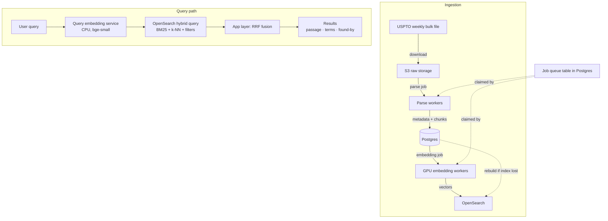

# Part 2 Design: Patent Search at Scale (10 Million Patents)

This document describes how the Part 1 hybrid search engine would be extended to handle
10 million patents. Part 1 runs entirely in-process — no external services, brute-force
exact search, everything in RAM. That works well for 640 patents and 32 k chunks. At
10 million patents the data no longer fits in a single machine's memory, the embedding
step takes real compute, and ingestion must be a durable pipeline rather than a one-off
script. The design below keeps the same retrieval model (BGE embeddings + BM25 + weighted
RRF fusion) and maps each Part 1 concept onto a scalable open-source component.

---

## System Diagram



---

## 1. What Gets Embedded

### The choice

In Part 1 every chunk is embedded: abstract, claims, and description paragraphs,
averaging about 50 chunks per patent. At 10 million patents that is roughly 500 million
vectors.

**Version 1 embeds claims and abstracts only**, about 20 chunks per patent.

The math (all figures are estimates; verify before budgeting):

| Scope | Precision | Vectors | Size |
|---|---|---|---|
| All chunks | float32 | ~500 M | ~770 GB |
| Claims + abstract | float32 | ~200 M | ~300 GB |
| Claims + abstract | **int8** | ~200 M | **~75 GB** |

Vector indexes must sit in RAM to serve queries at low latency — that is the main cost
driver. Cutting from float32 to int8 (storing each of the 384 dimensions as a signed
byte instead of a 4-byte float) reduces the memory footprint by 4×, bringing the whole
vector set into a medium-sized cluster. Quality loss from int8 quantization is typically
small for retrieval tasks (verify with your regression query set).

### The known weakness

Anything disclosed anywhere in an earlier patent counts as prior art, not only its
claims. Embedding only claims and abstracts means semantic matches that exist solely in
a description paragraph are missed. For example: a claim might say "a damping member
attached to the wheel hub", while the description adds "the damping member suppresses
vibration at highway speeds". A query for "vibration suppression at speed" would find
the description match but not the claim-only embedding.

### Phase 2 fix: binary quantization

Binary quantization stores each dimension as a single bit (0 or 1), yielding 384 bits =
48 bytes per vector. All ~500 million full-corpus chunks fit in roughly 24 GB — small
enough for a modest cluster. The workflow: binary vectors find the top few hundred
candidates quickly, then those candidates are re-scored with full-precision vectors kept
on disk. This is a standard two-stage ANN pattern; verify that the deployed OpenSearch
version supports binary k-NN before committing to it.

---

## 2. Components

### S3 — raw file archive

**In plain terms:** a cheap, permanent filing cabinet for the original USPTO XML/ZIP files
exactly as downloaded, one folder per weekly release.

**Technically:** an S3 bucket (or any object store). Workers read from it; no writes
after the initial download. If anything downstream breaks, the raw data is always
recoverable here.

### Postgres — source of truth

**In plain terms:** the database that knows about every patent, every chunk, and every
pipeline job. If the search index is ever lost or corrupted, it is rebuilt entirely from
Postgres.

**Technically:** stores patent metadata (doc_number, title, abstract, classification,
week), the parsed chunk text with type labels (`abstract` / `claim` / `paragraph`),
and the job queue table described in Section 3.

### OpenSearch — the search engine

**In plain terms:** one system that does everything the in-process Part 1 engine does,
but distributed across multiple machines.

**Technically:** OpenSearch handles BM25 with field boosts (mapped directly from Part 1's
abstract 1.5 / claim 1.2 / paragraph 1.0 boosts), phrase queries (using its built-in
positional index — this replaces Part 1's candidate-only phrase check), fuzzy matching,
spelling suggestions (via built-in suggesters — replaces Part 1's `difflib` scan), hard
filters, and vector (k-NN) search in a single query round-trip.

**Shard routing by classification code** is the scale equivalent of Part 1's
class-sorted contiguous layout. In Part 1, patents are sorted by `(classification,
doc_number)` so that a class filter resolves to a contiguous numpy slice `E[lo:hi]` —
a free view, no copy. In OpenSearch, routing queries to classification-specific shards
achieves the same effect: a class-filtered query touches only the shards that hold that
class. Large classes (e.g. B60C with ~318 patents in the small corpus) should be split
into sub-shards to avoid skew (see Section 7).

### Query embedding service

**In plain terms:** a small always-on process that turns a text query into a vector.

**Technically:** runs the same `BAAI/bge-small-en-v1.5` model used at indexing time,
on CPU. Applies the BGE instruction prefix
`"Represent this sentence for searching relevant passages: "` to every query — just as
Part 1 does, and critically never applies it to documents. It must be the identical model
and identical prefix; any mismatch silently degrades retrieval quality.

### GPU embedding workers

**In plain terms:** machines that turn patent text into vectors during ingestion.

**Technically:** consume embedding jobs from the Postgres queue, encode batches of chunk
text with `BAAI/bge-small-en-v1.5`, and write the resulting vectors into OpenSearch.
Self-hosted on rented GPU instances rather than an embedding API — see Section 4.

---

## 3. Ingestion Pipeline

```
USPTO weekly file → S3 → parse workers → Postgres (metadata + chunks)
                                        → embedding workers → OpenSearch
```

### Job queue

The queue is a Postgres table. Workers claim jobs atomically with
`SELECT ... FOR UPDATE SKIP LOCKED` — one row per job, one worker per row at a time.
No separate queue system (no Redis, no Kafka) is needed at this scale; the job table
also serves as the status table.

**Job states:**

```
pending → parsing → parsed → embedding → embedded → indexing → indexed
                                                              → failed → dead
```

A job moves to `failed` on error and to `dead` (dead-letter state) after exceeding the
maximum retry count. The error message is stored on the row for human review.

### Idempotency

Every job is keyed by `(doc_number, content_hash)` where `content_hash` is a hash of
the parsed text fields. Reprocessing a file never creates duplicate patents or chunks.

### Retries

Exponential backoff with a configurable cap (e.g. 5 attempts). After the cap, the job
moves to `dead`. Dead-letter count is a monitored metric (Section 8).

### Two modes

- **Backfill:** process the full historical corpus (~10 M patents) once. Workers run in
  parallel; this is an embarrassingly parallel workload.
- **Weekly incremental:** every time USPTO publishes a new weekly IPA file, download it
  to S3, create parse jobs for its patents, and run the same pipeline.

---

## 4. Embedding

Self-hosted `bge-small-en-v1.5` on rented GPU instances is preferred over a managed
embedding API for two reasons:

1. **Cost:** 10 M patents × ~20 chunks × ~60 tokens/chunk ≈ 12 billion tokens. At
   typical API rates that is hundreds of dollars, and managed APIs add rate limits.
   A mid-range GPU embeds a few thousand chunks per second; the full 200 M-chunk backfill
   takes roughly one day (estimate; depends on GPU model and batch size).

2. **Reproducibility:** you must be able to re-embed with the exact same model. A
   managed API can change its model under you.

**Model version tracking:** store the model name and a version tag alongside every
vector in OpenSearch. When the model changes, re-embed into a **new** index and switch
traffic via an index alias once the regression query set passes. Search never goes down
during a migration (blue/green pattern). The old index is kept as a rollback target
until the new one is validated.

---

## 5. Query Path

```
User query text
  → query embedding service (BGE prefix + encode, ~13 ms in Part 1)
  → OpenSearch hybrid query
      filters: classification shard routing + field-contains filters + exact-title lookup
      BM25: field-boosted (abstract 1.5 / claim 1.2 / paragraph 1.0)
      k-NN: cosine over int8 vectors, top 100
  → application layer: weighted RRF fusion
  → return top k with matched passage, matched terms, found-by label
```

### Fusion

Weighted RRF exactly as in Part 1:

```
rrf_score = 1/(60 + dense_rank) + 0.5/(60 + keyword_rank)
```

Ranks are 1-based. A patent absent from one list contributes 0 from that signal.
OpenSearch may support hybrid search and RRF natively depending on the version —
**verify against current OpenSearch docs before building the application-layer fusion**.
If RRF is not supported natively, the fallback is to run two queries (BM25 and k-NN)
separately and fuse them in the application, exactly as Part 1 does.

### Scale-specific query adjustments

- **Query term trimming is mandatory.** Part 1 already caps at 16 terms
  (`_MAX_QUERY_TERMS = 16`) for long claim queries. At 10 M patents, common terms
  have posting lists with millions of entries; keeping only the ~16 highest-IDF terms
  is essential for BM25 performance. The same logic applies unchanged.

- **Phrase checking** is native in OpenSearch via positional indexes. Part 1 checks
  phrases only on the top-200 candidate chunks to avoid a full-corpus scan — a correct
  tradeoff for small data. At scale, OpenSearch handles this transparently.

- **Spelling suggestions** use OpenSearch's built-in suggesters instead of Part 1's
  `difflib.get_close_matches` + shared-prefix scan over the in-memory vocabulary.

### Future feature: upload a patent

A user uploads a patent PDF. The system parses it, identifies independent claims (used
as search intent), extracts the abstract and distinctive non-stopword terms, suggests a
class code (shown but not auto-applied), and runs each independent claim as a separate
search. Because this involves multiple embedding calls and multiple searches, it runs as
an asynchronous job with a progress indicator rather than a blocking HTTP request.

---

## 6. Cost (Rough Estimates)

All figures are order-of-magnitude estimates. Verify against current cloud pricing
before committing.

| Item | Rough estimate |
|---|---|
| OpenSearch cluster (dominant cost: 75 GB of vectors in RAM) | low thousands of dollars/month |
| Managed Postgres | a few hundred dollars/month |
| S3 raw storage (~1 TB for 10 M patents) | tens of dollars/month |
| GPU embedding backfill (one-time, ~1 day of GPU time) | tens of dollars, one-time |
| Query embedding service (small CPU instance, always-on) | tens of dollars/month |

The OpenSearch cluster is the dominant recurring cost because the vector index must stay
in RAM. Moving to binary quantization (Phase 2) would shrink this significantly.

---

## 7. Challenges

**Filtered approximate vector search can miss valid results.** When a classification
filter is very selective (e.g. "only B60D, which has ~3% of patents"), an approximate
k-NN search over the full index may return few or no results from that small class. The
mitigation is to switch to exact (brute-force) search when the filtered set is small —
the same idea as Part 1's gather-vs-mask planner, which uses fancy indexing over a small
matching set rather than masking a large contiguous range. Verify how the deployed
OpenSearch version handles filtered k-NN before relying on it.

**Full re-embeds on model change** are handled by the blue/green alias swap described in
Section 4. The regression query set (Section 8) gates the switch.

**Shard skew.** Classification codes are not evenly distributed. In Part 1's small
corpus, B60C has ~318 patents and B60D has ~20. At scale this imbalance could make some
shards much larger than others, hurting query latency. Mitigation: split large classes
into sub-shards based on a secondary sort key such as `doc_number` range.

**Data quality.** Old USPTO patents contain OCR errors, missing fields, and
non-standard claim formats. Part 1 already handles missing fields gracefully (stores as
empty, logs skips). At scale, parse failures move to the dead-letter state rather than
crashing the worker, so bad records don't block the rest of the pipeline.

**The description-embedding gap** (Section 1). The v1 decision to skip description
embeddings is a known recall tradeoff, not an oversight.

**Regression risk.** A fixed benchmark query set runs automatically after every reindex
and after every model change. Silent quality drops (e.g. from a field mapping change in
OpenSearch) are caught before they reach users.

---

## 8. Monitoring and Status

| Metric | Why it matters |
|---|---|
| Job counts by state (pending / parsing / embedded / dead …) | shows pipeline health at a glance |
| Ingestion lag: newest USPTO week vs newest indexed week | alerts if the weekly job is stuck |
| Dead-letter count | surfaces parse or embed failures needing human review |
| Query p50 / p95 latency | catches performance regressions |
| Regression-set scores after each reindex | catches silent quality regressions |

---

## 9. Proof of Concept

`poc/` contains a self-contained ingestion job queue simulator:

- SQLite stands in for Postgres (SQLite has no `SKIP LOCKED`; workers claim jobs with an
  atomic `UPDATE … RETURNING` on SQLite 3.35+ or `BEGIN IMMEDIATE + SELECT + UPDATE` on
  older versions).
- Multiple worker processes run concurrently, each with its own connection.
- Transient failures, permanent-poison docs, and worker crashes are injected at
  configurable rates to exercise retry, dead-letter, and lease-recovery paths.
- A status report shows job counts per state, throughput, retries, lease recoveries,
  and the dead-letter list at any point.

### Run commands

```bash
# One-command end-to-end demo (init, seed, run, status, mutate + re-run):
python -m poc.demo

# Or step by step:
python -m poc.queue init
python -m poc.queue seed
python -m poc.queue run --workers 4
python -m poc.queue status

# Re-seed with 5 mutated patents (only those 5 get new jobs):
python -m poc.queue seed --mutate 5
python -m poc.queue run --workers 4

# Move dead jobs back to ready for a retry:
python -m poc.queue retry-dead
```

### Sample demo output (abbreviated)

```
==================================================
ThinkStruct Part 2 POC - Ingestion Queue Demo
==================================================

--- 1. Initialise database and seed patents ---

$ python -m poc.queue init
--------------------------------------------------
SQLite 3.54.1: using UPDATE...RETURNING
Initialized poc/queue.db

$ python -m poc.queue seed
--------------------------------------------------
Seeded 640 patents: 640 new job(s), 0 unchanged (INSERT OR IGNORE)

--- 2. Seed again (should add 0 new rows) -----

$ python -m poc.queue seed
--------------------------------------------------
Seeded 640 patents: 0 new job(s), 640 unchanged (INSERT OR IGNORE)

--- 3. Run workers with default failure rates -

$ python -m poc.queue run --workers 4
--------------------------------------------------
SQLite 3.54.1: using UPDATE...RETURNING
Workers: 4  fail_rate: 0.2  poison: 12  crash_rate: 0.01
Worker w1 crashed (exit 1), restarting...
...
Finished in 17.1s

State         Count      %
----------------------------
  dead           16   2.5%
  indexed       624  97.5%
Throughput: 37.5 jobs/sec
Retries: 525   Lease recoveries: 28

Dead-letter queue (16 job(s)):
  20240066918  stage=embedding  error=poison: permanent failure
  ...

--- 5. Mutate 5 patents; only those 5 reprocess

$ python -m poc.queue seed --mutate 5
--------------------------------------------------
Seeded 640 patents: 5 new job(s), 635 unchanged (INSERT OR IGNORE)

$ python -m poc.queue run --workers 4
--------------------------------------------------
Finished in 2.0s
```

### What the POC demonstrates (mapped to the design)

- **Idempotent keys:** `(doc_number, content_hash)` with `INSERT OR IGNORE` means
  re-seeding 640 unchanged patents adds 0 new rows; only mutated patents (changed hash)
  produce new jobs. This matches the Section 3 idempotency contract.
- **Atomic claims:** `UPDATE … RETURNING` (or `BEGIN IMMEDIATE` on older SQLite) ensures
  no two workers ever process the same job-stage simultaneously. The `test_no_double_claim`
  and `test_no_overlapping_events` tests verify this.
- **Exponential backoff and dead-letter:** transient failures retry with growing delays
  (`base * 2^attempts + jitter`); the 2.5% dead rate in the demo output shows poison docs
  exhausting `max_attempts=4` and landing in dead with `last_error` preserved for human review.
- **Lease recovery:** when a worker crashes mid-job (`os._exit(1)`), the supervisor
  restarts it and the next worker's `recover_leases()` call returns the stale job to its
  ready state, counting one attempt. The 28 lease recoveries in the demo output confirm this.
- **Status tracking:** the `events` append-only audit log records every stage attempt with
  `started_at`, `finished_at`, outcome, and error, providing the per-state counts, throughput,
  retry counts, and dead-letter list shown by `poc.queue status`.

Production would replace SQLite with Postgres and `UPDATE … RETURNING` with
`SELECT … FOR UPDATE SKIP LOCKED` as described in Section 3.

---

## 10. Build Order for an Intern

Each step is independently testable before the next one starts.

| Step | Deliverable | How to test |
|---|---|---|
| 1 | Postgres schema + job table | `INSERT` a row, `SELECT FOR UPDATE SKIP LOCKED`, check state transitions |
| 2 | USPTO XML parser | Parse one file; assert doc_number, chunks, classification present |
| 3 | Embedding worker | Embed 100 chunks; assert float32 L2-norm ≈ 1 per vector |
| 4 | OpenSearch index mapping + bulk loader | Load 1 000 patents; run a BM25 query; check a k-NN query returns results |
| 5 | Query service | Run the Part 1 benchmark queries; compare RRF results to Part 1 baseline |
| 6 | Monitoring | Confirm job-count and lag metrics update after a small ingestion run |
| 7 | Backfill | Run on a sample of 100 k patents; verify latency and cost are on track |
| 8 | Weekly incremental | Download the next USPTO weekly file; verify it flows through to indexed state |

---

## Flags and Inconsistencies with Part 1 Code

No inconsistencies were found. All references in this document were verified against the
actual source:

- Weighted RRF weights (1.0 / 0.5), 60-constant, 1-based ranks: confirmed in
  `search/engine.py` lines 311–334.
- Type weights (abstract 1.0, claim 1.0, paragraph 0.9): confirmed in
  `search/dense.py` lines 27–31.
- Field boosts (abstract 1.5, claim 1.2, paragraph 1.0): confirmed in
  `search/keyword.py` lines 37–41.
- BM25 parameters (k₁ = 1.2, b = 0.75): confirmed in `search/keyword.py` lines 34–35.
- `_MAX_QUERY_TERMS = 16`: confirmed in `search/keyword.py` line 43.
- BGE query prefix applied to queries only: confirmed in `search/dense.py` lines 22–23.
- Class filter via `bisect_left` on sorted `codes` list: confirmed in `search/engine.py`
  lines 105–108.
- Gather-vs-mask planner at 25% threshold: confirmed in `search/engine.py` lines
  249–256.
- Phrase bonus +2.0 on top-200 candidates only: confirmed in `search/keyword.py`
  lines 44–45 and 307–319.
- Embedding cache keyed on SHA-1 of chunk texts: confirmed in `search/dense.py`
  lines 41–49.
